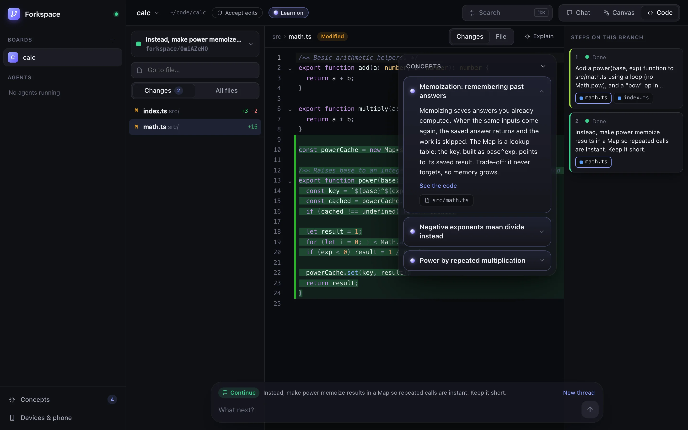

# Forkspace

**The editor for the age of agents.** An open source editor for [Claude Code](https://docs.anthropic.com/en/docs/claude-code) agents: run many on one canvas, branch any conversation from any step (the code branches too), review every change as a live diff, and learn the concepts behind the code.

[](https://github.com/nikhils4/forkspace/releases)
[](LICENSE)
[](https://nodejs.org)
[](https://github.com/nikhils4/forkspace/stargazers)



[Website](https://forkspace-app.netlify.app) · [Changelog](CHANGELOG.md) · [Discussions](https://github.com/nikhils4/forkspace/discussions) · Built by [nikhils4](https://github.com/nikhils4)

- **Direct.** Every prompt becomes a step on a canvas. Branch from any step and the code branches with it. Run many agents side by side.
- **Review.** See each branch's files with a live diff. Follow the agent as it edits. Approve risky steps right where they happen, even from your phone.
- **Learn.** As agents work, Forkspace explains the concepts behind their code in plain words, using your actual code.

Runs on your machine. Use it from the browser, as an installed app, or from your phone.

## Quick start

You need Node 20+, git, and an Anthropic API key.

```bash
git clone https://github.com/nikhils4/forkspace && cd forkspace
npm install
export ANTHROPIC_API_KEY=sk-ant-...   # from https://console.anthropic.com
npm start                             # builds, then serves http://localhost:4747
```

Then, in **Settings**:

- **Keep running in the background** (macOS): starts Forkspace at login and restarts it if it stops. No terminal needed after this.
- **Install the app** from your browser for its own window and Dock icon.

Forkspace is a third-party app, so it signs in with an API key. Anthropic's terms ask third-party apps not to use Claude.ai logins.

### Updating

Forkspace ships as versions (see [CHANGELOG.md](CHANGELOG.md)). When one is out, the sidebar shows **Update to x.y.z**. Open Settings to read what's new and click **Update**. Forkspace downloads it, reinstalls if needed, rebuilds, restarts, and the page reloads itself. It won't update while agents are running.

- Edits you made in the Forkspace folder are kept. If the update changes the same files, you get **Set aside my edits and update**, which moves them into `git stash` (bring them back with `git stash pop`).
- Pulled by hand while Forkspace was running? Settings shows **Update** to rebuild and restart.

By hand: `git pull && npm install && npm start`.

Maintainers: add a section to CHANGELOG.md, then `npm run release -- 0.3.0` (or `patch`, `minor`, `major`). It bumps the version, tags it with the notes, pushes, and makes a GitHub release.

## How it works

- **Board:** one project folder.
- **Step:** one prompt and everything the agent did for it.
- **Reply** to the latest step to continue. **Branch** from any earlier step to try another idea. The agent remembers the conversation up to that step and nothing after it.
- **Notes:** double-click the canvas (or press `n`). They sit above cards and land in free space. Write `- [ ] task` for a checklist you can tick, `# ` for a heading, `**bold**`. Paste or drop an image on a note and choose **Add image** or **Turn into text** (it types out what's written in the picture). Notes you want to keep but not see all the time (on-call steps, setup commands) go to **Notes** with the folder button; open them there to edit, or put them back on the canvas. Drag between dots to link anything.
- **Screenshots:** set your app's address (like `http://localhost:3000`) in board settings and Forkspace snaps it after each step that changes files, using the Chrome you already have. The newest screenshot becomes the thread's cover, so you can see at a glance what each thread built. You can also paste (`⌘V`) onto a selected step, drop an image on a card, or pick one from the card's menu.
- **Complete:** each thread has a circle above its first card. Click it when the thread is finished: it fills with a green tick and the whole thread fades back, so what's left stands out.

### Three views

| View | What it's for |
|---|---|
| **Chat** | Any branch as a conversation. Tap a branch point to switch. |
| **Canvas** | Every step and branch on one map, with your notes. **Tidy up** arranges it; zoom out for titles only. |
| **Code** | The branch's files and a live diff of everything the agents changed. **Follow agent** opens each file as it's edited. |

Switching views keeps your place. Press `⌘K` to jump to any board, branch, file or action.

### Terminal

Click **Terminal** in the top bar (or press `Ctrl+\``) for a real shell at the bottom of the board, already in the folder of the branch you're on. Open more with **+**. Terminals keep running when you hide the panel, and reopening shows what was on screen.

Phones and other paired devices can't open a terminal unless you allow it on the computer itself (Settings, Phone). On Linux the terminal needs build tools for `node-pty`; everything else works without it.

### Concepts

While an agent works, a small, fast model (no tools) reads what it did and writes one concept at a time: a short plain-language explanation with the real code behind it. For example, *"Memoization: remembering past answers"* when an agent adds a cache.

- Concepts appear beside the code, in the chat, and on canvas cards.
- **Explain** any step or file on demand.
- Every concept is saved to your **Concepts** library.

Each idea is taught once. Concepts get one short name across all your boards (like "memoization"), so the same idea showing up again links to the one you already have instead of repeating.

The **Map** view (Concepts → Map) groups everything by where it belongs in tech: Algorithms, Performance, Web and networking, and so on. Pick a concept to read it, see what it connects to, and jump to the steps where you learned it.

Turn it off per board with the **Learn** pill in the top bar.

### Branching the code, not just the chat

With **Separate copy per branch** (the default for git repos):

1. Each branch works in its own git worktree under `~/.forkspace/worktrees/`, on a branch named `forkspace/<id>`.
2. After every step, Forkspace commits that worktree, as you (your own git name and email), with a short conventional message written from the actual changes (`fix(cart): …`, `feat: …`) in your repo's style, including a ticket like `ENG-1234` if your prompt, the conversation or your branch mentions one. The commit is the step's checkpoint.
3. Branching from a step starts a new worktree at its checkpoint, so the branch sees the code exactly as it was then.

Branches never overwrite each other. To keep a result, merge its `forkspace/<id>` branch like any other. A step's **Details** panel shows the branch, folder and diff, plus a command to continue from that exact point in your terminal.

**Same folder** mode works without git, but every agent edits the same files. Agents start from your last commit, so commit anything they need first.

### Bring in your Claude Code sessions

Already worked in this folder with the Claude Code extension or CLI? When you create a board, Forkspace offers to bring those sessions in (or use **Bring in Claude Code sessions** from the branch list or `⌘K`). Each prompt becomes a step you can continue or branch from.

- Continuing runs in your real folder, just like the original session.
- Branching starts from a snapshot of the folder as it is now, including uncommitted work. Your checkout and git staging are never touched.

## What runs behind the scenes

No magic. Here is everything, in plain words.

| Part | What it is |
|---|---|
| **The agents** | The same Claude Code you already use, through Anthropic's [Agent SDK](https://docs.anthropic.com/en/docs/claude-code/sdk). Your `~/.claude` settings, `CLAUDE.md`, MCP servers, hooks and skills all come along. |
| **The concepts** | A small, fast Claude model (Haiku) reads what the agent just did (its steps and changes) and writes one idea in plain words. It has no tools, so it can't read or change your files by itself. |
| **Your key** | Agents and concepts both run on your Anthropic API key, from your machine. Concepts cost a sliver of what the agents do. |
| **Your code** | Never leaves your computer. Branches are plain git worktrees. Sessions are saved where Claude Code keeps them (`~/.claude/projects`), so `claude --resume` works on them too. |
| **Forkspace** | A small Node server on your machine plus a web page. Nothing is sent anywhere except the model calls to Anthropic. |

Why an API key and not your Claude.ai login? Anthropic asks apps built on Claude Code to use API keys. If no key is set, the SDK may fall back to an existing Claude Code login on your machine, but the supported way is a key.

## Away mode

Stepping away? Click **Away mode** in the sidebar. Your computer stays awake while Forkspace runs, and the screen turns into a calm away screen: the time, what your agents are doing, and whether your phone is connected. Click **I'm back** for a summary of what happened.

- macOS uses `caffeinate`, Windows its own power settings, Linux `systemd-inhibit`. It stops by itself if Forkspace stops.
- Optional: keep the screen on too.
- It stays on across restarts and updates until you turn it off.
- On a MacBook, stay plugged in and leave the lid open. A closed or unplugged laptop can still sleep, and Forkspace tells you when you're on battery.
- No phone connected yet? **Bring your phone along** walks you through it one step at a time, right on the away screen. Each step moves on by itself.

## Moving to another Mac

In **Settings → Move to another Mac**, click **Export everything**. You get one `.forkspace` file with every board, step, note and concept, the Claude Code conversations behind them, and each branch's code (as a git bundle). Your access key and paired devices are not included.

On the other Mac:

1. Install Forkspace and clone or copy your projects.
2. Open **Settings → Move to another Mac → Import a file** and choose the file.
3. Check where each project lives (Forkspace guesses from the old path) and click **Import**.

Conversations continue where they left off and code branches come back as their own copies. Boards already on that Mac are skipped, so importing twice is safe. If a branch's code needs commits your copy of the repo doesn't have yet, pull first and import again.

## On your phone

Agents always run on your Mac. Your phone is a remote control.

1. Install [Tailscale](https://tailscale.com/download) on your Mac and phone, signed in to the same account.
2. In Forkspace, open **Settings**, find **Use Forkspace on your phone**, and turn it on. This serves Forkspace over HTTPS to your own devices only.
3. Scan the QR code with your phone, or open the address and type the 6-digit code.
4. On iPhone: Share, then **Add to Home Screen**, and pair from the installed app.

Turn on **Notifications** per device to get a ping when an agent needs you or finishes. On the phone you get Chat, Canvas and Code views, an **Agents** tab with Allow and Deny, and your Concepts.

Any other HTTPS tunnel works too: set its address in Settings.

## Permissions

Pick per board, change any time.

| Mode | Behaviour |
|---|---|
| Ask me | Risky steps wait for Allow, Always or Deny |
| Accept edits | File edits run on their own; commands still ask |
| Auto | Safe steps run; unsure ones ask |
| Plan only | Reads and plans, changes nothing |
| Full access | Never asks. Only for throwaway folders. |

Anything waiting on you glows amber, shows under **Agents** in the sidebar, and adds a count to the tab title.

## Shortcuts

| Key | Action |
|---|---|
| `Enter` | Send (`Shift+Enter` for a new line) |
| `/` or `r` | Focus the message box |
| `⌘K` or `⌘P` | Search boards, branches, files and actions |
| `1` `2` `3` | Chat, Canvas, Code |
| `Esc` | Start a new thread instead of replying |
| `n` | New note |
| `⌘\` | Hide or show the sidebar |
| `Ctrl+`` ` | Terminal |
| `Backspace` | Delete selected steps (and their branches) or notes |
| Double-click a step | Open details |
| Right-click (long-press on a phone) | Menu for a step, note or empty canvas: reply, branch, explain, copy, recolour, delete |
| Right-click a board, or its `···` | Board settings, **Start fresh** (clear every card, keep the board), Delete board |

## Settings

In the app: **Appearance** (System, Light, Dark; also the sun and moon button in the sidebar), phone access and pairing, notifications, background mode, updates, and **Sign out others**.

Environment variables:

| Variable | Default | |
|---|---|---|
| `ANTHROPIC_API_KEY` | | Required |
| `PORT` | `4747` | |
| `HOST` | `127.0.0.1` | Keep it on localhost; agents can run commands on this machine |
| `FORKSPACE_HOME` | `~/.forkspace` | State, worktrees and logs |
| `FORKSPACE_EDITOR` | | Editor command for **Open in editor**. Without it, Forkspace tries VS Code, Cursor, then Finder. |
| `FORKSPACE_MENTOR_MODEL` | `haiku` | Model that writes concepts |

## Security

- Every connection needs an access key. Pages on the Mac itself get it automatically. Other devices pair with a 6-digit code that expires after 5 minutes, and wrong guesses are rate limited.
- A request only counts as local when it reaches the server directly over loopback, with a localhost `Host` header and no proxy headers. This blocks DNS rebinding and tunnelled requests.
- File reads are locked to the board's folder; `../` paths and symlinks that point outside are refused.
- **Sign out others** (Settings) rotates the key, so every paired device has to pair again.
- Keys live in `~/.forkspace/auth.json` and `push.json` (mode 600).

Forkspace runs agents with your user's permissions. Use Tailscale or another private tunnel for remote access; don't expose the port publicly.

## Development

```bash
npm run dev        # server with reload + Vite on http://localhost:5173 (Node 22.18+)
npm run typecheck
npm run build      # client to dist/, server to build/
```

- `server/`: agent runner (Claude Agent SDK), worktrees and checkpoints, concepts, sessions import, updates, auth.
- `client/`: React app (canvas, chat, code view, settings), installable as a PWA.
- `shared/`: types shared by both.
- `site/`: the website.

## Roadmap

- Merge a branch back from the app
- Search across every step and note

## Contributing

Bug reports, ideas and pull requests are welcome. See [CONTRIBUTING.md](CONTRIBUTING.md). Questions go in [Discussions](https://github.com/nikhils4/forkspace/discussions). Security issues: see [SECURITY.md](SECURITY.md).

If Forkspace helps you, a star helps others find it.

## License

MIT · Built by [nikhils4](https://github.com/nikhils4). An independent project, not made by Anthropic.
